<div align="center">

# Parallax

### The same Google search gives different answers in different parts of India.

Type a search. Parallax runs it through **SerpApi** from 12 Indian cities, 10 Indian languages or 10 countries at the same moment. It then tells you, in plain words, what changes, who gets heard where, and what you'd miss from where you are.

`SerpApi India Hackathon 2026` · Track: **Knowledge & Public Interest** · #BuiltWithSerpApi

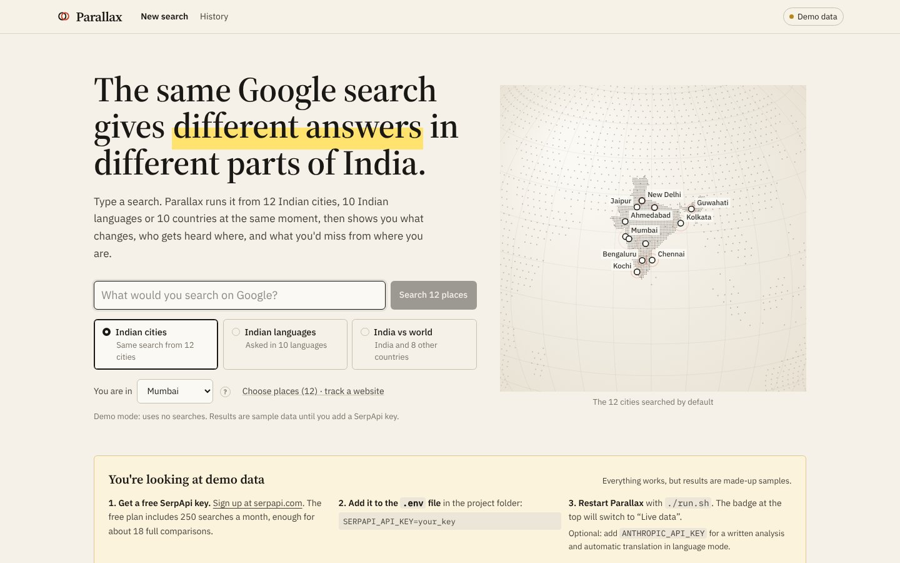

</div>

---

## Why this matters

Most people never scroll past the first page of Google, and they only ever see it from one place. But Google tailors that page to where you are and what language you use. Someone in Guwahati and someone in Mumbai can type the same words and come away believing different things: different news outlets, different shops, a different AI answer, or no AI answer at all.

Filter bubbles are usually discussed for social feeds. **Search is the bigger and quieter one**, and in a country with 22 official languages and strong regional media it is very large. Until now there was no easy way for an ordinary person to *see* it.

## Who it's for

| Who | What they get |
|---|---|
| **Journalists and fact-checkers** | Which outlets each city is shown for a story, and which local sources everyone else misses |
| **Businesses and marketers** | Where their website ranks in every city, where it's missing, and which competitors beat it there. Works with no extra searches |
| **Students and researchers** | The same question asked in Hindi, Tamil, Bengali and seven more languages, plus CSV/JSON export of every result |
| **Anyone curious** | A plain-language answer to “does where I search change what I see?”, and a list of sources outside their bubble |

---

## What you get from one search

**1. The short answer.** One sentence in plain English, followed by four numbers anyone can read:
*“6.2 of 10 top links differ between any two places”*, *“7 of 12 places show the same #1 result”*, *“6 groups of places see similar pages”*, *“5 of 12 places got Google's AI answer”*. Every number has a **?** that explains it. A written analysis (by Claude when a key is set) ends with a concrete *What to do*.

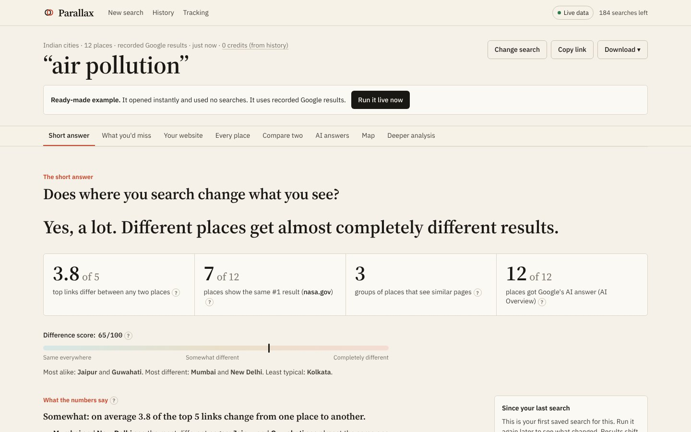

**2. What you'd miss.** Pick your city. Parallax lists the sources other places see on page one that you never do, ranked by how many places see them. It also lists the sources only you see.

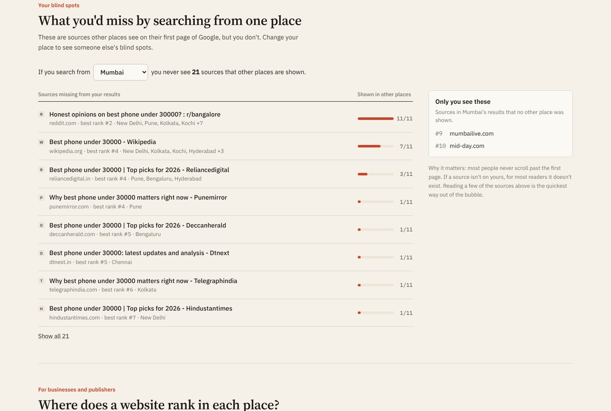

**3. Where does a website rank?** Enter any domain (yours or a competitor's). You get its rank in every place, where it isn't on page one, where Google's AI answer cites it, and who outranks it most often. It's computed from results already fetched, so it's **free**.

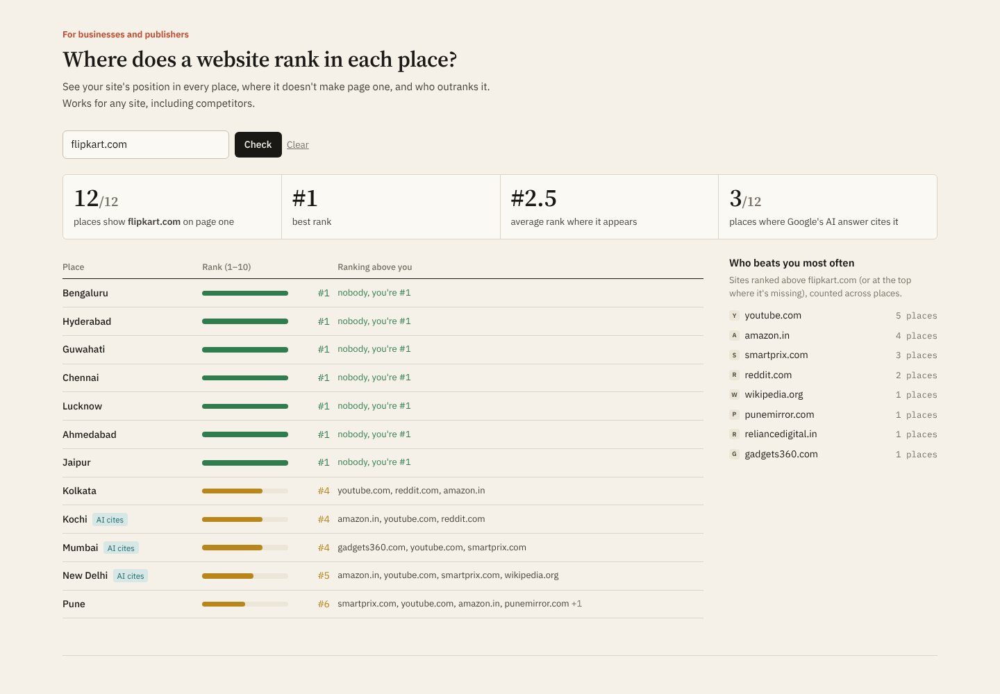

**4. Every place, side by side.** Each place's first page in columns, grouped by similarity. Click a website to highlight it everywhere. Sources only one place sees are outlined.

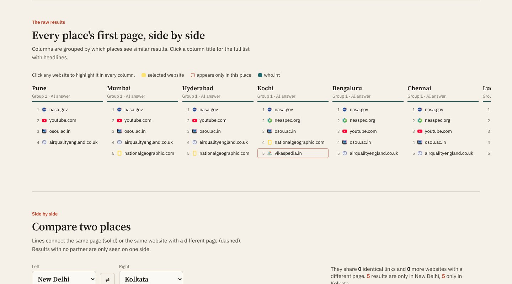

**5. Compare two places.** Two result pages with lines linking the same page or the same website. Results only one side sees are flagged.

**6. Google's AI answers.** Where an AI Overview appeared, its full text, and a grid of which sources it cited in each place.

**7. Map and groups.** The places on a map, coloured by which ones see the same thing.

**8. Deeper analysis (for researchers).** A similarity matrix, how each website's rank moves from place to place, the source mix (news / government / social / shops …), page features, unusually common words per place, and a Google Trends map of Indian states.

### Four things worth showing a judge

**Google's AI answer, compared word by word.** For many searches Google now writes an AI Overview above the results. Parallax puts two places' AI answers side by side and highlights the wording that appears in only one of them. By default it picks the two places whose answers differ most, and it reports how much wording all the AI answers share on average. It's careful about what this shows: different wording isn't automatically a different claim, so the highlights are there to be read, not counted as "bias".

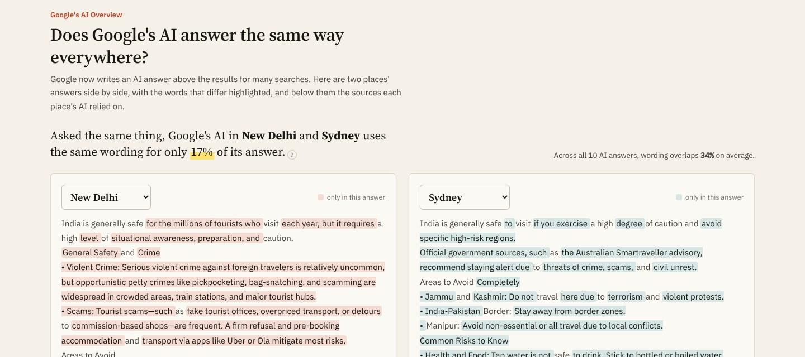

**Who controls the top 3.** Every #1–#3 result across all places is counted, along with how many websites hold them. Example: *“Just 2 websites (wikipedia.org and youtube.com) hold 43% of all top-3 spots across 10 places. Half of those spots belong to 3 sites.”* The result is rated *concentrated*, *somewhat concentrated* or *spread out*, using top-2 share and the Herfindahl index.

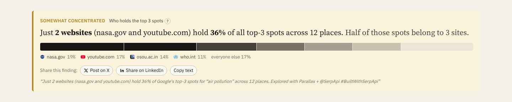

**A cost & cache receipt.** Every result page ends with a receipt: requests by SerpApi engine (Search, AI Overview follow-ups, Trends), how many were fetched live and billed versus served from cache, credits used, credits saved, and credits left this month. For example: *“12 places searched. 10 served from cache, 2 fetched live. Saved 10 SerpApi credits.”* Reopened scans show 0 credits.

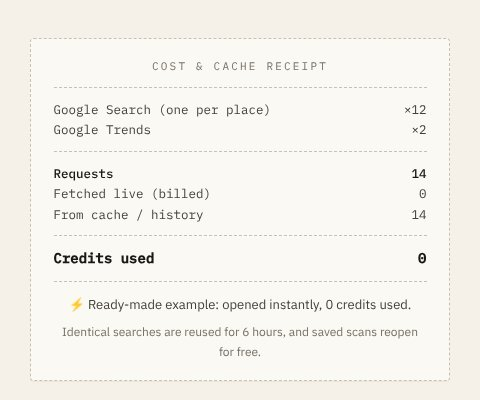

**One-click sharing.** Under the AI answer diff and the top-3 finding there's a *Share this finding* row: post to X, share on LinkedIn, copy, or use the phone's share sheet. The text is written for you, for example *“Just 2 websites (wikipedia.org and youtube.com) hold 43% of Google's top-3 spots for ‘air pollution’ across 12 places. Explored with Parallax + @SerpApi #BuiltWithSerpApi”*. Findings from demo data are tagged “[sample data]” so made-up numbers never travel as real ones.

**Zero-friction start.** On first run Parallax builds six ready-made examples, so the start page shows the most divided one before you type anything. **🎲 Surprise me** opens one of the most divided examples instantly, at no cost. The examples are built from recorded SerpApi responses when you've recorded them (`python -m parallax.record "<query>"`, then `python -m parallax.examples`), and otherwise from labelled sample data.

### Built to be used, not just looked at

- **History.** Every search is saved locally. Reopening one is instant and uses no SerpApi searches.
- **What changed since last time.** Run a search again later and Parallax tells you which places got a new #1 result and how many new sources appeared.
- **Shareable links.** The URL always points at the saved search, your chosen city and your tracked site.
- **Downloads.** A spreadsheet (CSV, one row per result), a written Markdown report, raw JSON, a 1200×630 share image, or print / save as PDF.
- **Live progress.** A checklist of places shows results arriving instead of a spinner.
- **Credit-aware.** Before you search it tells you how many SerpApi searches it will use and how many you have left. It warns you if that's more than you have, and repeats within 6 hours are free.
- **Clear setup.** With no API key it runs on clearly labelled demo data and shows the three steps to switch to live data.
- **Works on phones.** The layout works at phone width.

| Live progress | History | Share image | Mobile |
|---|---|---|---|
| 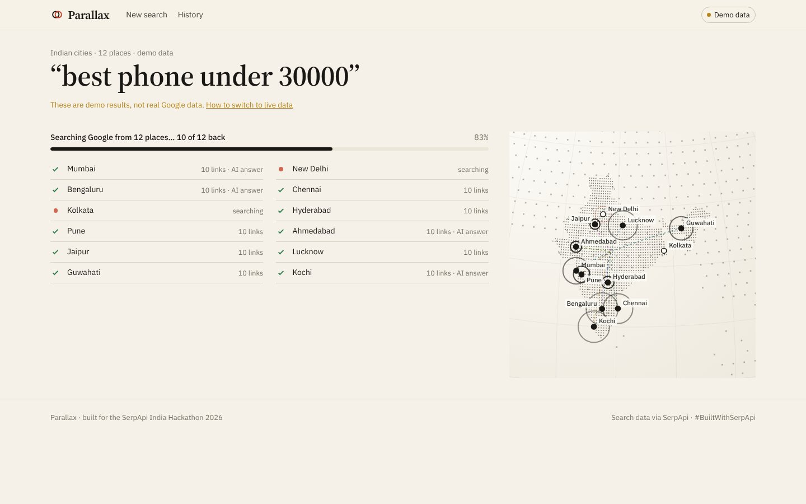 | 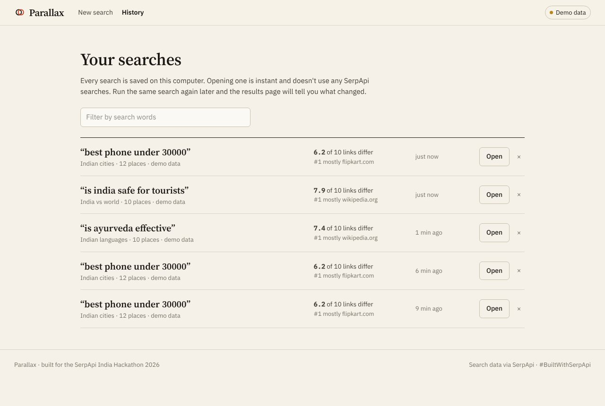 | 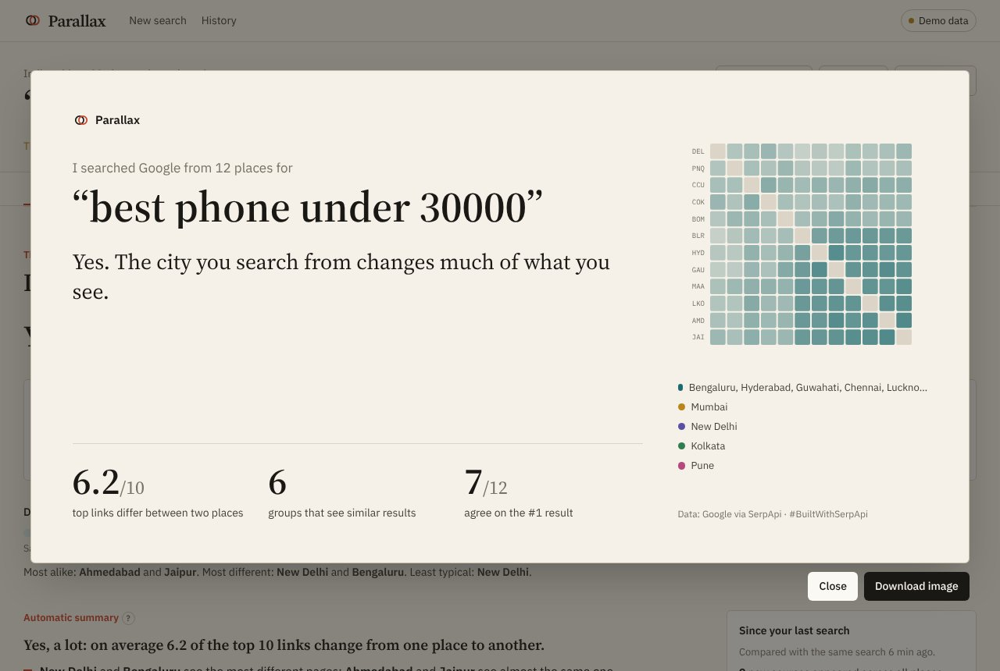 | 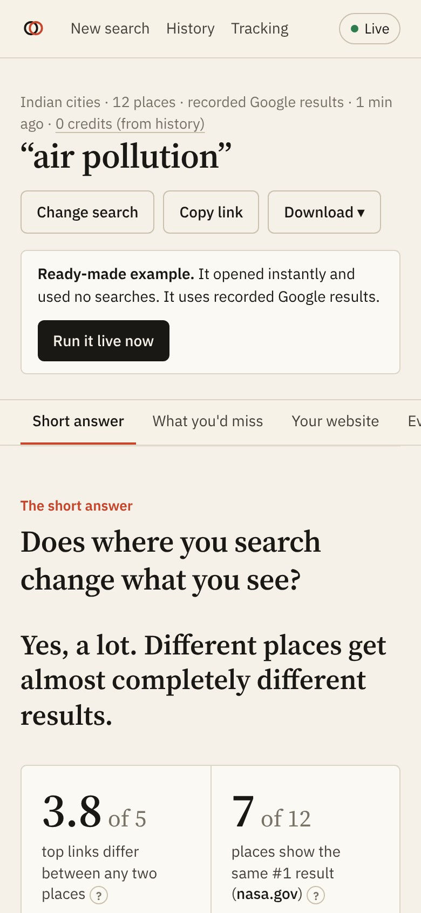 |

<sub>Screenshots were taken in offline demo mode (synthetic sample data). With a SerpApi key every number comes from live Google results.</sub>

### Three ways to compare

| Mode | Places | What changes between them |
|---|---|---|
| **Indian cities** | Mumbai, Delhi, Bengaluru, Chennai, Kolkata, Hyderabad, Pune, Ahmedabad, Jaipur, Lucknow, Guwahati, Kochi | Location only. Same language, same country |
| **Indian languages** | English, हिन्दी, বাংলা, தமிழ், తెలుగు, मराठी, ગુજરાતી, ಕನ್ನಡ, മലയാളം, ਪੰਜਾਬੀ, each from a city where it's spoken | Language and location. The search is translated into each script by Claude |
| **India vs world** | Delhi, Mumbai, New York, San Francisco, London, Dubai, Singapore, Toronto, Sydney, Dhaka | Country, Google domain and location |

You can switch off any place to save searches, or **add any place on Earth** (autocomplete from the SerpApi Locations API).

---

## How it uses SerpApi

SerpApi is the core of the product, not an add-on. **The whole idea depends on precisely controlling *where* and *in what language* Google is queried**, which is exactly what SerpApi's `location`, `gl`, `hl` and `google_domain` parameters provide, as structured JSON, in parallel.

| SerpApi product | Used for | Why it matters |
|---|---|---|
| **Google Search API** (`engine=google`) | One search per vantage, run in parallel, with `location`, `gl`, `hl`, `google_domain` | The raw material: organic ranks, SERP features, local pack, top stories, knowledge graph, related questions |
| **Google AI Overview API** (`engine=google_ai_overview`) | Follows `page_token` when an AI Overview loads lazily | Lets PARALLAX compare *what Google's AI says and cites* per place |
| **Google Trends API** (`engine=google_trends`, `GEO_MAP_0` + `TIMESERIES`, `geo=IN`) | State-level interest map and 12-month curve | Adds *demand* to *supply*: where India actually searches for the topic |
| **Locations API** (free) | "Add any place on Earth" autocomplete | Canonical Google location strings for custom vantages |
| **Account API** (free) | “Searches left” in the header and the pre-search estimate | Keeps credit usage visible, since the free tier is 250 searches/month |
| **Official `serpapi` Python SDK** | All of the above | `serpapi.Client(...).search()`, `.locations()`, `.account()` |

**Credit-aware by design.** One scan costs about *(number of vantages + 2)* searches. Responses are cached on disk (6 h by default), and SerpApi's own cached results are free, so re-opening a scan costs nothing. The UI shows credits used, how many results were cached, and credits remaining. You can switch individual vantages off before a scan.

---

## The maths

- **Rank-Biased Overlap (RBO)** (Webber, Moffat & Zobel, 2010) compares every pair of ranked lists with persistence *p = 0.9*, so agreement at #1 counts far more than agreement at #9. It's computed on canonicalised URLs (*same page*) and on registrable domains (*same source*), then blended 60/40.
- **Plain-language numbers** shown first: average number of top-10 links that differ between two places, #1-result agreement, number of groups, and AI-answer count.
- **Difference score** = `100 × (1 − mean pairwise RBO)`, shown as a meter from “same everywhere” to “completely different”.
- **Realities**: average-linkage agglomerative clustering on `1 − RBO`, cut at 50% similarity. The dendrogram leaf order also sorts the matrix and the rank rivers so similar places sit next to each other.
- **Distinctive vocabulary**: weighted log-odds ratios with an informative Dirichlet prior (Monroe, Colaresi & Quinn, 2008), comparing each vantage's titles and snippets against the rest.
- **Source taxonomy**: news / government (`.gov.in`, `.nic.in` …) / academic / reference / social / commerce, from a curated India-first domain list.
- **Script detection**: Unicode-block counting (Devanagari, Bengali, Tamil, Telugu, Gujarati, Gurmukhi, Kannada, Malayalam …) to show which language results are in.

All of it lives in [`backend/parallax/analysis.py`](backend/parallax/analysis.py) and is covered by tests.

---

## Architecture

```
┌──────────────── React + TypeScript + Vite + Tailwind ───────────────────┐
│ Canvas dot-globe (d3-geo) · SVG matrix / bump chart / diff · motion     │
│ EventSource ← Server-Sent Events: plan → vantage×N → analysis → trends  │
│                                   → brief (token stream) → done         │
└──────────────────────────────────┬──────────────────────────────────────┘
                                   │ /api/scan (SSE)
┌──────────────────────────────────┴─────────── FastAPI (Python) ─────────┐
│ engine.py   asyncio fan-out (bounded concurrency) → serpapi SDK         │
│ serp.py     disk cache · record/replay fixtures · offline demo          │
│ normalize.py raw SERP → comparable shape (URL canonicalisation, eTLD+1) │
│ analysis.py RBO · clustering · log-odds · taxonomy · AI-overview overlap│
│ brief.py    Claude plain-language analysis + query translation          │
│ storage.py  SQLite history: reopen for free, “what changed since”       │
│ mcp_server.py  the same engine exposed as an MCP tool for AI agents     │
└─────────────────────────────────────────────────────────────────────────┘
```

Results stream to the browser as each search lands, so the progress checklist and map fill in place by place. Finished searches are saved to SQLite and the URL switches to the saved copy.

---

## Run it locally

**Requirements:** Python 3.10+ and Node 18+.

```bash
git clone https://github.com/shrithu10/serp_api_hackathon.git
cd serp_api_hackathon
cp .env.example .env        # add SERPAPI_API_KEY (and optionally ANTHROPIC_API_KEY)
./run.sh                    # installs deps, builds the UI, serves http://localhost:8000
```

<details>
<summary>Manual setup / dev mode with hot reload</summary>

```bash
python3 -m venv .venv && .venv/bin/pip install -r backend/requirements.txt
cd backend && ../.venv/bin/uvicorn parallax.app:app --reload --port 8000   # terminal 1
cd frontend && npm install && npm run dev                                   # terminal 2 → http://localhost:5173
```
</details>

### The command line

```text
$ cd backend && python -m parallax
██████╗  █████╗ ██████╗  █████╗ ██╗     ██╗      █████╗ ██╗  ██╗
...
[PARALLAX v1.0] - One query. Twelve Indias.  Search data via SerpApi

  ✓ SerpApi key found: live Google results (Search · AI Overview · Trends · Locations · Account)
  ✓ Disk cache ready: 41 saved responses, reused for 6 h (repeat searches cost 0 credits)
  ✓ History database ready: 7 saved searches, 6 ready-made examples (parallax.db)
  ✓ 32 vantage points across 3 lenses (cities · languages · world)
  ✓ Claude analyst enabled: written analysis + query translation
  ✓ Web interface built
  ✓ MCP tool server available: `python -m parallax mcp` (tools: parallax_scan, parallax_lenses)

  → Open http://localhost:8000
```

Every line is a real startup check: missing keys show as warnings, and broken setups as errors with the fix. The other commands:

| Command | What it does |
|---|---|
| `python -m parallax` | Start the web app (`--port`, `--host`, `--reload`, `--quiet`) |
| `python -m parallax check` | Run the startup checks only (exit code 1 if something is broken) |
| `python -m parallax mcp` | Run the MCP tool server on stdio for AI agents |
| `python -m parallax record "query" --lens cities` | Record real SerpApi responses for offline demos |
| `python -m parallax examples` | Rebuild the ready-made example scans |

| Variable | Required | Purpose |
|---|---|---|
| `SERPAPI_API_KEY` | for live data | Free key at [serpapi.com](https://serpapi.com/users/sign_up), 250 searches/month |
| `ANTHROPIC_API_KEY` | optional | Claude writes the field report and translates queries for the language lens |
| `PARALLAX_CACHE_TTL` | optional | Seconds to reuse a cached SerpApi response (default 21600) |
| `PARALLAX_RECORD` | optional | `1` = also save responses to `backend/fixtures/` for offline demos |

**No key? It still runs.** Without `SERPAPI_API_KEY`, PARALLAX switches to **demo mode** with clearly labelled synthetic sample data, so you can explore the whole interface. To demo on *real* data offline, record a scan once:

```bash
cd backend && ../.venv/bin/python -m parallax.record "is ayurveda effective" --lens cities
```

Recorded fixtures are then replayed whenever the key is absent.

### Use it from an AI agent (MCP)

```json
{
  "mcpServers": {
    "parallax": {
      "command": "/path/to/serp_api_hackathon/.venv/bin/python",
      "args": ["-m", "parallax", "mcp"],
      "cwd": "/path/to/serp_api_hackathon/backend"
    }
  }
}
```

Tools: `parallax_scan(query, lens)` returns the index, realities, exclusives and per-vantage top results. `parallax_lenses()` lists the lenses. An agent can check *"would someone in Kolkata see the same thing I'm seeing?"* before trusting a single search.

### Tests

```bash
cd backend && ../.venv/bin/python -m pytest -q
```

---

## Project layout

```
backend/parallax/
  app.py          FastAPI app, SSE scan endpoint, static UI
  engine.py       parallel SerpApi fan-out shared by API, MCP and recorder
  serp.py         SerpApi gateway: SDK calls, cache, fixtures, demo fallback
  vantages.py     cities / languages / world presets → SerpApi params
  normalize.py    SERP → comparable records
  analysis.py     RBO, clustering, log-odds, taxonomy, AI-overview overlap
  brief.py        Claude plain-language analysis and translation (+ offline fallback)
  storage.py      saved searches (SQLite), previous-run lookup for change tracking
  mcp_server.py   MCP tools for agents
  record.py       record real responses as replayable fixtures
  demo.py         labelled synthetic data for keyless exploration
frontend/src/
  components/     Landing, ScanForm, Progress, Summary, BlindSpots, SiteReport,
                  ByPlace, SerpDiff, AiLens, DotGlobe, Inspector, Matrix, Rivers,
                  Anatomy, IndiaHeat, History, ExportMenu, ShareCard, Help …
  lib/scan.ts     SSE client + reducer (live scans and reopened ones)
  lib/derive.ts   blind spots, website report, change tracking, CSV/Markdown export
  lib/url.ts      shareable URLs
```

---

## Limitations and honesty notes

- SerpApi reproduces Google *for a location and language*. It does not reproduce a signed-in user's personal history, so PARALLAX measures **geographic and linguistic** divergence, not personalisation.
- Google results change hour to hour. A scan is a snapshot, and cached results are reused for up to 6 hours unless you change `PARALLAX_CACHE_TTL`.
- Source categories come from a curated list. Unknown domains fall into "Other web".
- Demo-mode data is synthetic and is always labelled as such in the UI.

## License

MIT
