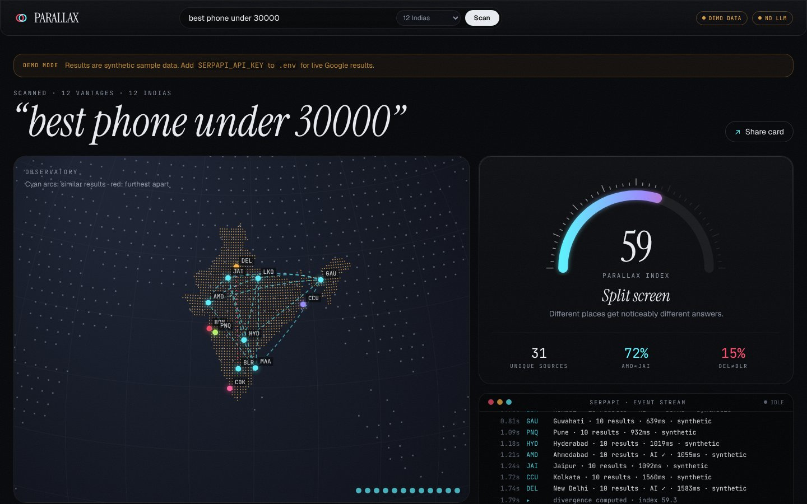
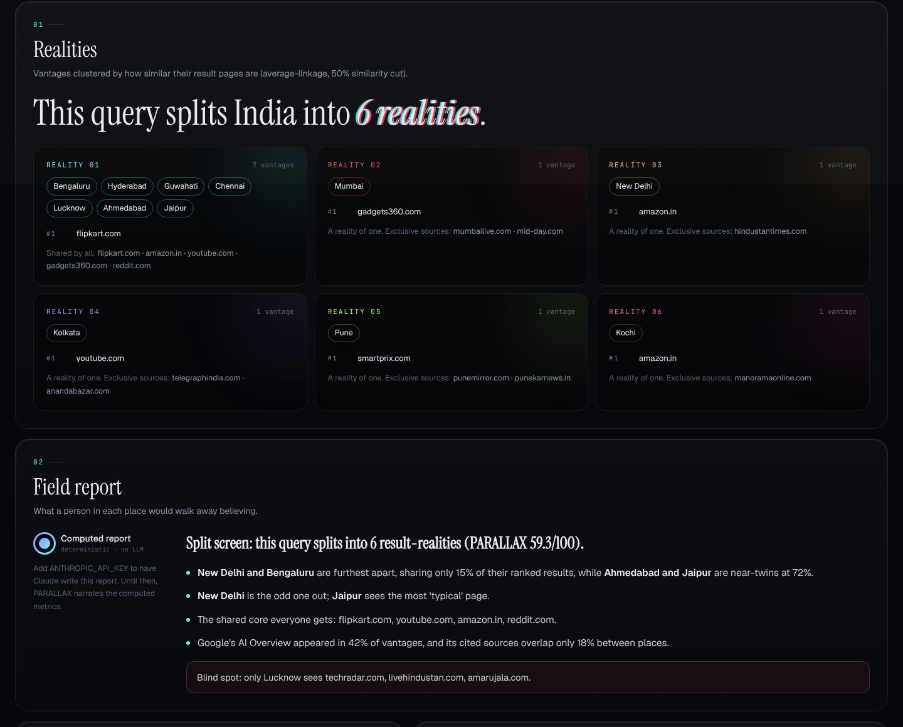
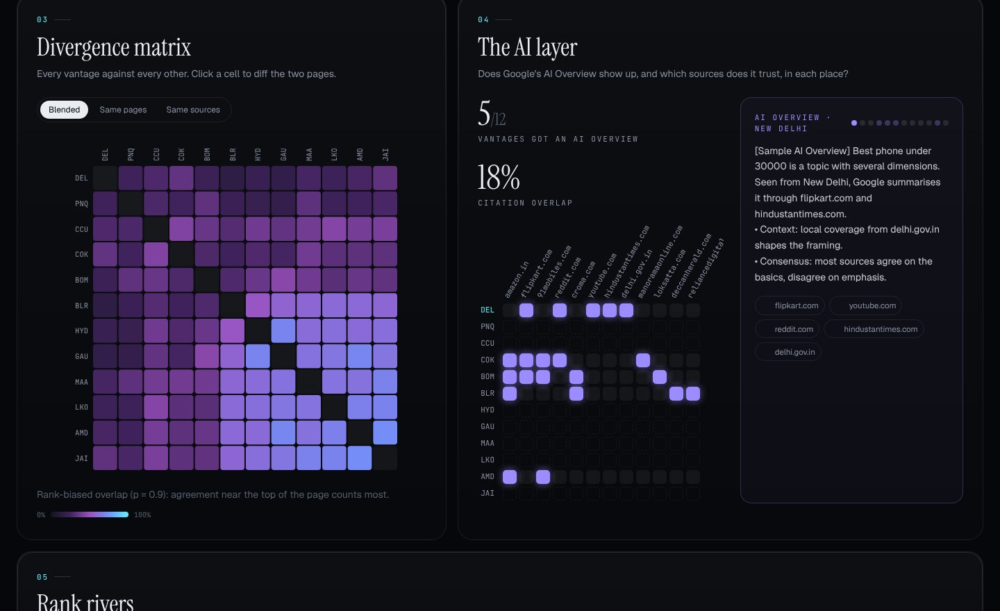
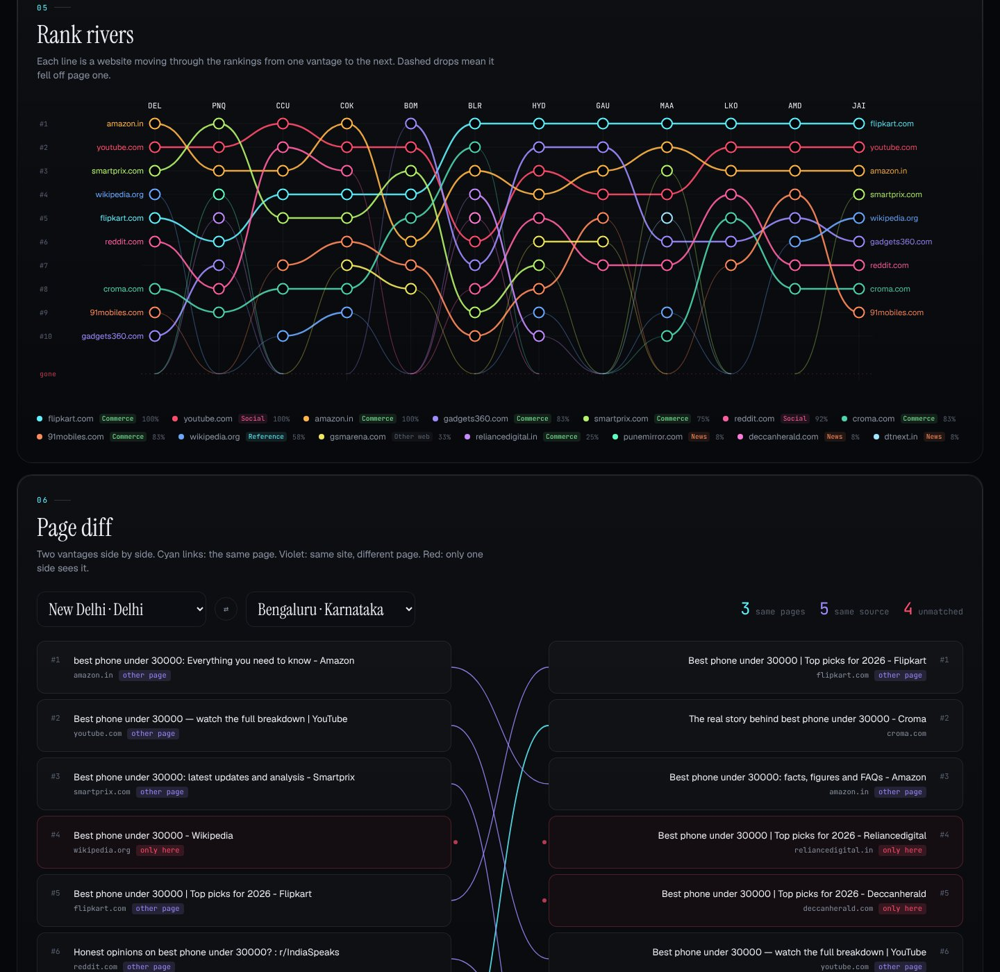
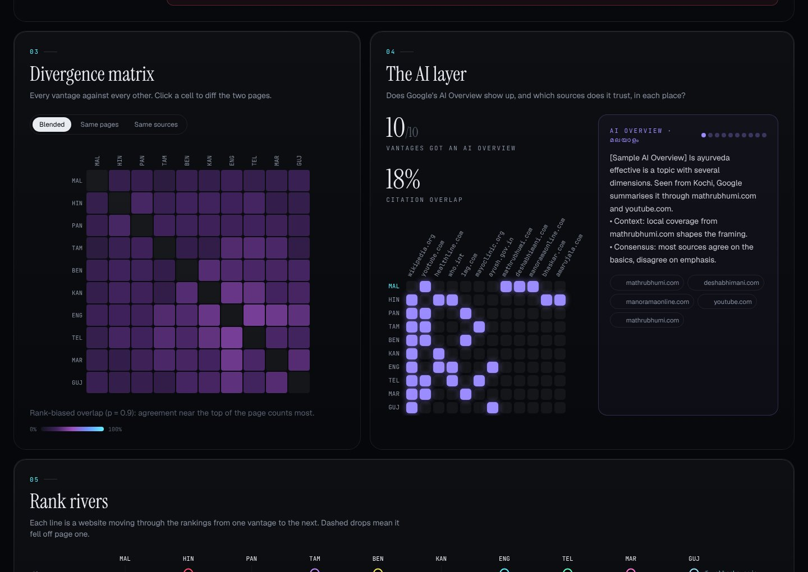
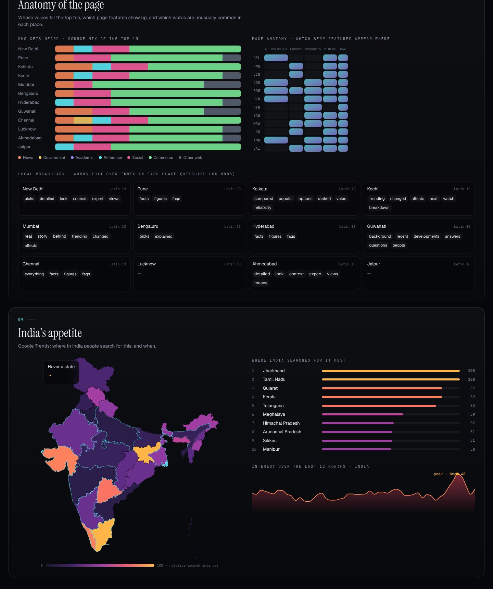

<div align="center">

# PARALLAX

### One query. Twelve Indias.

**Google doesn't show everyone the same internet.** PARALLAX runs one search from a dozen Indian cities, ten Indian languages or ten countries at the same moment through **SerpApi**, then measures how far the results drift apart and shows the drift.

`SerpApi India Hackathon 2026` · Track: **Knowledge & Public Interest** · #BuiltWithSerpApi


</div>

---

## The insight

Two people in Chennai and Guwahati type the same question, *"is ayurveda effective"* or *"best phone under 30000"*. They get different top-ten lists, different AI Overviews, different local voices and a different picture of what is true.

Most people never see this, because you can only ever look at search from where you are. Filter bubbles are usually discussed in terms of social media feeds. **Search is the bigger and quieter one**, and in a country with 22 official languages and huge regional media ecosystems, the gap is large.

PARALLAX makes that bubble **measurable**. It asks:

- **How fragmented is reality for this query?** It gives a single 0–100 *Parallax index*.
- **Which places live in the same "reality"?** It clusters vantages by result similarity.
- **Who gets heard where?** It shows sources that rank only in one place, the shared core, and the news / government / social / commerce mix.
- **Does Google's AI say the same thing everywhere?** It checks whether an AI Overview appears and which sources it cites, per vantage.
- **What changes when you ask in Tamil instead of English?** The language lens rewrites the query natively and compares.

**Who it helps:** journalists and fact-checkers checking regional framing, researchers studying information access, SEO and brand teams checking visibility across Indian markets, educators teaching media literacy, and anyone curious about what the internet looks like from somewhere else.

---

## What it looks like

| Observatory: results stream in live | Realities and field report |
|---|---|
|  |  |

| Divergence matrix and AI Overview layer | Rank rivers and page diff |
|---|---|
|  |  |

| Language lens (native scripts) | Anatomy and India Trends heat map |
|---|---|
|  |  |

<sub>Screenshots above were taken in offline demo mode (synthetic sample data). With a SerpApi key, every number comes from live Google results.</sub>

### Three lenses

| Lens | Vantages | What changes |
|---|---|---|
| **12 Indias** | Mumbai, Delhi, Bengaluru, Chennai, Kolkata, Hyderabad, Pune, Ahmedabad, Jaipur, Lucknow, Guwahati, Kochi | `location` only. Same language, same country. |
| **10 Tongues** | English, हिन्दी, বাংলা, தமிழ், తెలుగు, मराठी, ગુજરાતી, ಕನ್ನಡ, മലയാളം, ਪੰਜਾਬੀ, each from its home city | `hl` + `location`, and the query is translated into that script by Claude |
| **India vs World** | Delhi, Mumbai, New York, San Francisco, London, Dubai, Singapore, Toronto, Sydney, Dhaka | `gl`, `google_domain` and `location` |

You can also **add any place on Earth** as a custom vantage. It autocompletes through the SerpApi Locations API.

### Nine views

1. **Observatory**: a hand-drawn dotted globe on canvas. Vantages pulse while their SerpApi search is in flight and light up as results land. Arcs then connect places that see similar results; the red arc joins the two most different places.
2. **Parallax index**: 0 = everyone sees the same page; 100 = parallel universes.
3. **Realities**: the clusters, and the sources that everyone inside one cluster shares.
4. **Field report**: Claude writes an analyst's brief of the scan, streamed live. A computed report is used when no LLM key is set.
5. **Divergence matrix**: every vantage against every other, by same pages, same sources, or blended. Click a cell to diff the two places.
6. **The AI layer**: AI Overview presence plus a citation matrix (which sources Google's AI trusts in each place).
7. **Rank rivers**: a bump chart that traces each website's rank across vantages, including when it falls off page one.
8. **Page diff**: two SERPs side by side, with curves linking the same page (cyan) or the same site (violet). Results only one side sees are flagged red.
9. **Only here / Anatomy / India's appetite**: sources exclusive to one vantage, the source-type mix, SERP features, distinctive local vocabulary, and a Google Trends choropleth of Indian states plus a 12-month timeline.

There's also a **Share card** that exports a 1200×630 PNG summary of any scan.

---

## How it uses SerpApi

SerpApi is the core of the product, not an add-on. **The whole idea depends on precisely controlling *where* and *in what language* Google is queried**, which is exactly what SerpApi's `location`, `gl`, `hl` and `google_domain` parameters provide, as structured JSON, in parallel.

| SerpApi product | Used for | Why it matters |
|---|---|---|
| **Google Search API** (`engine=google`) | One search per vantage, run in parallel, with `location`, `gl`, `hl`, `google_domain` | The raw material: organic ranks, SERP features, local pack, top stories, knowledge graph, related questions |
| **Google AI Overview API** (`engine=google_ai_overview`) | Follows `page_token` when an AI Overview loads lazily | Lets PARALLAX compare *what Google's AI says and cites* per place |
| **Google Trends API** (`engine=google_trends`, `GEO_MAP_0` + `TIMESERIES`, `geo=IN`) | State-level interest map and 12-month curve | Adds *demand* to *supply*: where India actually searches for the topic |
| **Locations API** (free) | "Add any place on Earth" autocomplete | Canonical Google location strings for custom vantages |
| **Account API** (free) | Live "credits left" badge | Keeps credit usage visible, since the free tier is 250 searches/month |
| **Official `serpapi` Python SDK** | All of the above | `serpapi.Client(...).search()`, `.locations()`, `.account()` |

**Credit-aware by design.** One scan costs about *(number of vantages + 2)* searches. Responses are cached on disk (6 h by default), and SerpApi's own cached results are free, so re-opening a scan costs nothing. The UI shows credits used, how many results were cached, and credits remaining. You can switch individual vantages off before a scan.

---

## The maths

- **Rank-Biased Overlap (RBO)** (Webber, Moffat & Zobel, 2010) compares every pair of ranked lists with persistence *p = 0.9*, so agreement at #1 counts far more than agreement at #9. It's computed on canonicalised URLs (*same page*) and on registrable domains (*same source*), then blended 60/40.
- **Parallax index** = `100 × (1 − mean pairwise RBO)`.
- **Realities**: average-linkage agglomerative clustering on `1 − RBO`, cut at 50% similarity. The dendrogram leaf order also sorts the matrix and the rank rivers so similar places sit next to each other.
- **Distinctive vocabulary**: weighted log-odds ratios with an informative Dirichlet prior (Monroe, Colaresi & Quinn, 2008), comparing each vantage's titles and snippets against the rest.
- **Source taxonomy**: news / government (`.gov.in`, `.nic.in` …) / academic / reference / social / commerce, from a curated India-first domain list.
- **Script detection**: Unicode-block counting (Devanagari, Bengali, Tamil, Telugu, Gujarati, Gurmukhi, Kannada, Malayalam …) to show which language results are in.

All of it lives in [`backend/parallax/analysis.py`](backend/parallax/analysis.py) and is covered by tests.

---

## Architecture

```
┌──────────────── React + TypeScript + Vite + Tailwind ───────────────────┐
│ Canvas dot-globe (d3-geo) · SVG matrix / bump chart / diff · motion     │
│ EventSource ← Server-Sent Events: plan → vantage×N → analysis → trends  │
│                                   → brief (token stream) → done         │
└──────────────────────────────────┬──────────────────────────────────────┘
                                   │ /api/scan (SSE)
┌──────────────────────────────────┴─────────── FastAPI (Python) ─────────┐
│ engine.py   asyncio fan-out (bounded concurrency) → serpapi SDK         │
│ serp.py     disk cache · record/replay fixtures · offline demo          │
│ normalize.py raw SERP → comparable shape (URL canonicalisation, eTLD+1) │
│ analysis.py RBO · clustering · log-odds · taxonomy · AI-overview overlap│
│ brief.py    Claude field report + native-script query translation       │
│ mcp_server.py  the same engine exposed as an MCP tool for AI agents     │
└─────────────────────────────────────────────────────────────────────────┘
```

Results stream to the browser as each search lands. The globe lights up city by city instead of showing a spinner.

---

## Run it locally

**Requirements:** Python 3.10+ and Node 18+.

```bash
git clone https://github.com/shrithu10/serp_api_hackathon.git
cd serp_api_hackathon
cp .env.example .env        # add SERPAPI_API_KEY (and optionally ANTHROPIC_API_KEY)
./run.sh                    # installs deps, builds the UI, serves http://localhost:8000
```

<details>
<summary>Manual setup / dev mode with hot reload</summary>

```bash
python3 -m venv .venv && .venv/bin/pip install -r backend/requirements.txt
cd backend && ../.venv/bin/uvicorn parallax.app:app --reload --port 8000   # terminal 1
cd frontend && npm install && npm run dev                                   # terminal 2 → http://localhost:5173
```
</details>

| Variable | Required | Purpose |
|---|---|---|
| `SERPAPI_API_KEY` | for live data | Free key at [serpapi.com](https://serpapi.com/users/sign_up), 250 searches/month |
| `ANTHROPIC_API_KEY` | optional | Claude writes the field report and translates queries for the language lens |
| `PARALLAX_CACHE_TTL` | optional | Seconds to reuse a cached SerpApi response (default 21600) |
| `PARALLAX_RECORD` | optional | `1` = also save responses to `backend/fixtures/` for offline demos |

**No key? It still runs.** Without `SERPAPI_API_KEY`, PARALLAX switches to **demo mode** with clearly labelled synthetic sample data, so you can explore the whole interface. To demo on *real* data offline, record a scan once:

```bash
cd backend && ../.venv/bin/python -m parallax.record "is ayurveda effective" --lens cities
```

Recorded fixtures are then replayed whenever the key is absent.

### Use it from an AI agent (MCP)

```json
{
  "mcpServers": {
    "parallax": {
      "command": "/path/to/serp_api_hackathon/.venv/bin/python",
      "args": ["-m", "parallax.mcp_server"],
      "cwd": "/path/to/serp_api_hackathon/backend"
    }
  }
}
```

Tools: `parallax_scan(query, lens)` returns the index, realities, exclusives and per-vantage top results. `parallax_lenses()` lists the lenses. An agent can check *"would someone in Kolkata see the same thing I'm seeing?"* before trusting a single search.

### Tests

```bash
cd backend && ../.venv/bin/python -m pytest -q
```

---

## Project layout

```
backend/parallax/
  app.py          FastAPI app, SSE scan endpoint, static UI
  engine.py       parallel SerpApi fan-out shared by API, MCP and recorder
  serp.py         SerpApi gateway: SDK calls, cache, fixtures, demo fallback
  vantages.py     cities / languages / world presets → SerpApi params
  normalize.py    SERP → comparable records
  analysis.py     RBO, clustering, log-odds, taxonomy, AI-overview overlap
  brief.py        Claude field report and query translation (+ offline fallback)
  mcp_server.py   MCP tools for agents
  record.py       record real responses as replayable fixtures
  demo.py         labelled synthetic data for keyless exploration
frontend/src/
  components/     DotGlobe, IndexGauge, LiveFeed, Realities, Brief, Matrix,
                  AiLens, Rivers, SerpDiff, Exclusives, Anatomy, IndiaHeat,
                  Inspector, ShareCard, Hero, VantagePicker
  lib/scan.ts     SSE client + reducer
```

---

## Limitations and honesty notes

- SerpApi reproduces Google *for a location and language*. It does not reproduce a signed-in user's personal history, so PARALLAX measures **geographic and linguistic** divergence, not personalisation.
- Google results change hour to hour. A scan is a snapshot, and cached results are reused for up to 6 hours unless you change `PARALLAX_CACHE_TTL`.
- Source categories come from a curated list. Unknown domains fall into "Other web".
- Demo-mode data is synthetic and is always labelled as such in the UI.

## License

MIT
