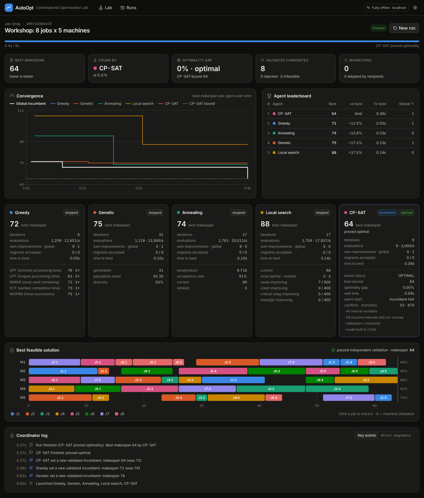
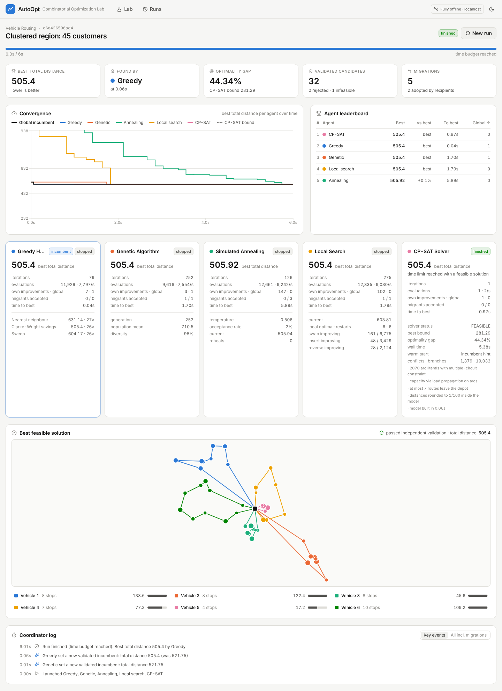
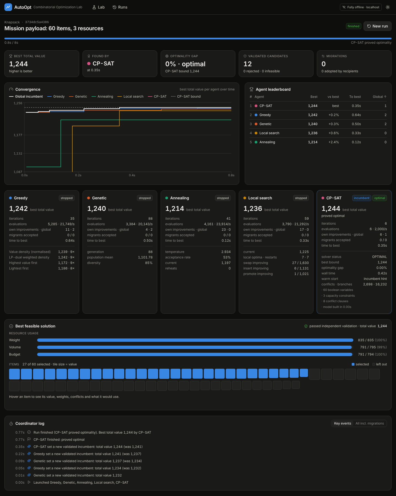

# AutoOpt: Autonomous Combinatorial Optimization Laboratory

AutoOpt is a local lab for combinatorial optimization. You define a problem, launch several optimization agents, and watch them search on their own and share good candidates. Then you compare how they did and inspect the best feasible solution, which a validator has checked.

It runs **entirely offline**. It uses no external API, cloud service, hosted model or remote solver, and needs no API key. All optimization runs locally on mathematical algorithms: OR-Tools CP-SAT, NumPy, SciPy and pure-Python metaheuristics. The UI and backend talk only over `localhost`, using REST and WebSockets.



## Quick start

```bash
./run.sh            # creates .venv, installs deps, builds the UI, serves http://127.0.0.1:8000
```

Requires Python 3.11+ and Node 18+. The network is needed **only for the first install** (pip and npm). After that the app runs with the network off.

Development mode (hot reload):

```bash
cd backend && python -m autoopt --port 8000      # API + WebSocket
cd frontend && npm install && npm run dev        # UI on :5173, proxies /api and /ws to :8000
```

Tests: `cd backend && pip install -r requirements-dev.txt && pytest`

## What it does

| Problem | Constraints | Objective | Visualisation |
|---|---|---|---|
| **Flexible Job Shop Scheduling** | job operation order, machine compatibility with machine-specific durations, cross-job precedence constraints, no machine overlap | minimise makespan | Gantt chart per machine, utilisation, job tracing |
| **Capacitated Vehicle Routing** | every customer visited once, vehicle capacity, fleet size | minimise total distance | route map, per-vehicle load and distance |
| **Multi-dimensional Knapsack** | several resource capacities at once, conflict pairs (never both) | maximise total value | resource usage bars, item map with conflicts |

Instances can be generated with parameters and a seed, edited as JSON (validated by Pydantic), and saved to a local library. Six example instances are seeded on first start.

### Agents

| Agent | How it searches | One step |
|---|---|---|
| **Greedy Heuristics** | Runs every constructive heuristic once without randomness, then GRASP-style randomised variants, each followed by a short local improvement. Heuristics: SPT/LPT/MWKR/ECT/MOPNR dispatching rules (job shop); nearest neighbour, Clarke-Wright savings, sweep (VRP); value density, **LP-dual weighted density from a SciPy/HiGHS LP relaxation**, highest value, lightest first (knapsack) | one construction |
| **Genetic Algorithm** | population (optionally seeded by heuristics), tournament selection, order crossover (plus uniform crossover of machine assignment), neighbourhood mutation, elitism | one generation |
| **Simulated Annealing** | auto-calibrated initial temperature (an average worsening move is accepted with p = 0.5), Metropolis acceptance, geometric cooling, reheat from the best solution | one temperature level |
| **Local Search** | hill climbing over swap / insert / reverse plus problem-specific moves (critical-path swap and machine reassignment for job shop; promote for knapsack), first or best improvement, variable neighbourhood descent, configurable stopping criterion, iterated-LS restarts | one descent iteration |
| **CP-SAT Solver** | exact model: optional interval variables + no-overlap (job shop); multiple-circuit + load propagation (VRP); boolean linear model (knapsack). Runs in native threads within the time limit, warm-started with the incumbent as a solution hint, reports status, best bound and gap | polled |

### Coordinator

`backend/autoopt/coordinator.py` is the orchestration engine:

- **Capability-based selection.** Each problem declares the operators it provides (`random_solution`, `neighborhood`, `crossover`, `constructive`, `cpsat`), and each agent declares what it needs. An agent runs only if the problem provides everything it needs. CP-SAT also checks a size limit. Agents that are skipped are listed with the reason.
- **Independent search states.** Each agent has its own state and its own random seed.
- **Compute budgets.** There is a global time budget and an optional stall limit, plus a per-agent iteration budget and compute weight. Python agents are round-robin time-sliced in proportion to their weight, while CP-SAT runs alongside in native threads.
- **Validation.** Every feasible candidate an agent reports is decoded and re-checked by an **independent validator**, which tests the raw constraints without trusting the decoder. Only validated candidates can become the global incumbent. Rejected and infeasible counts are shown.
- **Controlled migration.** At a set interval, the incumbent is offered only to agents that are behind it. Each recipient decides whether to adopt it: the GA replaces its worst individual, SA adopts it with a set probability, local search restarts from it, Greedy improves it, and CP-SAT uses it as a hint.
- **Stopping.** A run stops on the time budget, when all agents finish, on the stall limit, when CP-SAT proves optimality (optional), or when the user presses Stop.
- **Tracking.** The coordinator records the incumbent's improvement history (who improved it, and when) and each agent's convergence curve, then stores the full run in SQLite.

### Solution encodings

The metaheuristics share one implementation across problems because each problem turns a simple encoding into a feasible solution:

- **Job shop:** an operation priority list plus a machine assignment. The decoder releases operations in topological order and inserts each into the earliest idle gap on its machine, so every encoding is a feasible schedule. CP-SAT solutions convert back by sorting operations on their start times.
- **VRP:** a giant tour, cut into routes by **Prins' optimal split** (exact for a given order). Using more routes than there are vehicles counts as a violation.
- **Knapsack:** a priority list decoded greedily (add an item if it fits and does not conflict). Every candidate is feasible, and every optimal subset can be reached.

## UI

- **Lab:** choose a problem type, pick a library instance or generate one, edit it as JSON, configure each agent (on/off, compute weight, iteration budget, every algorithm parameter), and set the budget and coordination.
- **Run view (live over WebSocket):** progress, best objective, which agent found it, optimality gap against the CP-SAT bound (or the LP relaxation bound for knapsack), validation and migration counters, a convergence chart for each agent plus the global incumbent with the bound line, a leaderboard, agent cards with internal telemetry (temperature and acceptance rate, generation and diversity, move success rates, CP-SAT status, bound and gap), the solution view and the coordinator event log.
- **Runs:** every past run from SQLite. Open one to see its full final state.




## API

| Method | Path | |
|---|---|---|
| GET | `/api/meta` | problem types (with generator parameters) and agent catalogue |
| POST | `/api/instances/generate` | `{type, params, seed}` → instance |
| POST | `/api/instances/inspect` | validate an instance, summary and agent eligibility |
| GET/POST/DELETE | `/api/instances[/{id}]` | instance library |
| POST | `/api/runs` | `{instance_id}` or `{type, data}`, plus `config` → run id |
| GET | `/api/runs`, `/api/runs/{id}` | history and full snapshot |
| POST | `/api/runs/{id}/stop` | stop a run |
| WS | `/ws/runs/{id}` | `snapshot`, then `tick` (4/s), `event`, `incumbent`, and `finished` |

## Layout

```
backend/autoopt/
  problems/   base.py (interface + shared operators), jobshop.py, vrp.py, knapsack.py
  agents/     greedy.py, genetic.py, annealing.py, local_search.py, cpsat.py
  coordinator.py   orchestration engine
  runs.py          worker threads -> WebSocket fan-out
  db.py            SQLite (backend/.data/autoopt.sqlite3, override with AUTOOPT_DB)
  app.py           FastAPI app, also serves frontend/dist
frontend/src/      React + TypeScript + Tailwind + Recharts + Framer Motion + Lucide
```

## Adding a problem type

Subclass `Problem` (see `problems/base.py`), implement `random_solution`, `evaluate`, `decode`, `validate` and the JSON round trip, and add whichever operators you can: neighbourhoods, crossover, constructive heuristics, a CP-SAT model. Then register it in `problems/__init__.py`. The coordinator gives it every agent whose required capabilities it provides.
